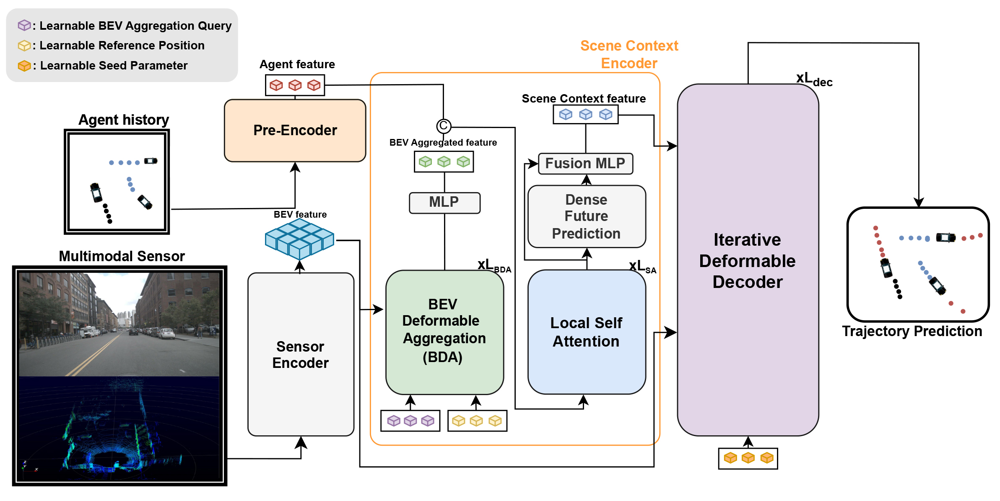

# BEVTraj

Trajectory prediction from raw sensor data without relying on HD maps.

## 📄 Paper

**BEVTraj: Map-free multimodal trajectory prediction with sensor-derived BEV context and sparse goal reasoning**

*Journal of Computational Design and Engineering (JCDE), 2026.*

[](https://doi.org/10.1093/jcde/qwag088)
[](https://arxiv.org/abs/2509.10080)



---

## 🛠️ Installation

BEVTraj builds on MMDetection3D, UniTraj, ScenarioNet, and BEVFusion.
Use Docker for the pinned environment, or follow the manual installation below.
Run the commands in this README from the repository root.

### Docker setup

Requirements:

- Docker Engine with the Compose plugin
- An NVIDIA GPU and driver
- [NVIDIA Container Toolkit](https://docs.nvidia.com/datacenter/cloud-native/container-toolkit/latest/install-guide.html)

Build the image and verify the installed packages, CUDA extensions, and GPU:

```bash
bash scripts/setup_docker.sh
```

The verification defaults to at least one GPU with compute capability 8.9
(RTX 4070/4090). Pass verification options for a different GPU or GPU count:

```bash
bash scripts/setup_docker.sh --expect-gpus 2 --expect-capability 8.6
```

The CUDA toolkit is included in the image. You do not need to install it on the host.

## 📦 Data preparation

Download and extract the dataset you intend to use:

- [nuScenes Dataset](https://www.nuscenes.org/nuscenes#download)
- [Argoverse 2 Dataset](https://argoverse.github.io/user-guide/getting_started.html)

Place the raw data under the following directories. Include the nuScenes maps,
which are used during conversion and visualization.

```text
BEVTraj/
├── data/
│   ├── nuscenes/
│   │   ├── maps/
│   │   ├── samples/
│   │   ├── sweeps/
│   │   └── v1.0-trainval/
│   └── av2_sensor/
│       ├── train/
│       └── val/
└── pretraining_ckpt/
```

AV2 conversion requires the `av2` SDK in the selected environment. The scripts
do not install or change SDK dependencies.

### Download pretrained weights

Download the BEVFusion segmentation checkpoint to `pretraining_ckpt/bevfusion-seg.pth`:

```bash
docker compose run --rm bevtraj bash scripts/download_pretrained.sh
```

The script reuses an existing checkpoint and only moves a download into place
after curl succeeds. This is the sensor encoder checkpoint; evaluation also
requires a trained BEVTraj checkpoint.

Source: [BEVFusion pretrained models](https://github.com/mit-han-lab/bevfusion#bev-map-segmentation-on-nuscenes-validation).

### Prepare a dataset

Run one command for the dataset you want to use:

```bash
# nuScenes
docker compose run --rm bevtraj bash scripts/prepare_data.sh nuscenes

# Argoverse 2 sensor
docker compose run --rm bevtraj bash scripts/prepare_data.sh argo2
```

Each command runs the following stages in order:

1. Generate MMDetection3D sensor info files and token-to-index mappings.
2. Convert training trajectories to ScenarioNet format.
3. Convert validation trajectories to ScenarioNet format.

The generated paths match the training configurations:

| Dataset | Sensor info and mappings | Training trajectories | Validation trajectories |
| --- | --- | --- | --- |
| nuScenes | `data/nuscenes/` | `data/nuscenes/prediction_converted_train` | `data/nuscenes/prediction_converted_val` |
| AV2 sensor | `data/av2_sensor/` | `data/av2_sensor/train_converted` | `data/av2_sensor/val_converted` |

To run only one stage, add `infos`, `train`, or `val`. For example, if validation
conversion is the only unfinished stage:

```bash
docker compose run --rm bevtraj bash scripts/prepare_data.sh nuscenes val
```

The scripts stop on errors. Existing ScenarioNet output directories are not
automatically overwritten; select an unfinished stage when resuming.

The default conversion worker counts are 1 for nuScenes and 4 for AV2. To override:

```bash
docker compose run --rm -e BEVTRAJ_WORKERS=4 bevtraj bash scripts/prepare_data.sh nuscenes
```

For a manual host installation, run the same scripts in your activated environment
without the `docker compose run --rm bevtraj` prefix.

## Train

```bash
# nuScenes, one GPU
docker compose run --rm bevtraj python unitraj/train.py method=bevtraj_nusc 'devices=[0]'

# Argoverse 2 sensor, one GPU
docker compose run --rm bevtraj python unitraj/train.py method=bevtraj_av2sensor 'devices=[0]'
```

For multi-GPU training, pass the GPU IDs, for example `'devices=[0,1,2,3]'`.
Checkpoints are saved under `ckpt/<exp_name>/` by default.

The default nuScenes configuration creates the trajectory cache on the first
run and reuses it on subsequent runs. Set `overwrite_cache: true` in
`unitraj/configs/method/bevtraj_nusc.yaml` to rebuild it after changing trajectory
preprocessing settings.

## Evaluate

Pass a trained BEVTraj checkpoint:

```bash
docker compose run --rm bevtraj python unitraj/evaluation.py method=bevtraj_nusc \
    ckpt_path=/path/to/bevtraj.ckpt 'devices=[0]'
```

The checkpoint path must be available inside the container. Files under the host
`ckpt/` directory are available at `/opt/bevtraj/ckpt/` in the container.

### Optional interactive container

```bash
docker compose up -d
docker compose exec bevtraj bash
```

Inside the container, run Python commands and preparation scripts directly.
Stop the service with `docker compose down`.

## Manual installation

The host needs a CUDA toolkit and compiler compatible with PyTorch and the native
extensions. The commands below retain the existing manual installation versions;
SDK dependency versions are not changed by the preparation scripts.

### 1. Environment and PyTorch

```bash
conda create -n bevtraj python=3.9
conda activate bevtraj
python -m pip install torch==1.12.1+cu116 torchvision==0.13.1+cu116 torchaudio==0.12.1 \
    --extra-index-url https://download.pytorch.org/whl/cu116
```

### 2. MMDetection3D and sparse convolutions

```bash
python -m pip install -U openmim
mim install mmengine
mim install 'mmcv==2.1.0'
mim install 'mmdet==3.2.0'
git clone https://github.com/open-mmlab/mmdetection3d.git ../mmdetection3d
python -m pip install -v -e ../mmdetection3d

# Use the spconv build appropriate for your CUDA environment.
python -m pip install spconv-cu118
```

### 3. MetaDrive and ScenarioNet

```bash
git clone https://github.com/metadriverse/metadrive.git ../metadrive
python -m pip install -e ../metadrive
git clone https://github.com/metadriverse/scenarionet.git ../scenarionet
python -m pip install -e ../scenarionet
```

### 4. BEVTraj

```bash
python -m pip install -r requirements.txt
python -m pip install -v --no-build-isolation -e .
```

BEVTraj's `setup.py` builds all four native extensions: `knn_cuda`,
`attention_cuda`, `bev_pool_ext`, and `voxel_layer`. A separate external BEVFusion
extension build and manual copying of `.so` files are not part of this setup.

After installation, follow **Data preparation** above, then run training or
evaluation directly with Python in the activated environment.

## License

This project is licensed under the MIT License.  

## Acknowledgments

This project builds upon the work of several open-source libraries and prior research.  
Special thanks to the authors of the following projects:

- [MMDetection3D](https://github.com/open-mmlab/mmdetection3d)
- [BEVFusion](https://github.com/mit-han-lab/bevfusion)
- [UniTraj](https://github.com/vita-epfl/UniTraj)
- [ScenarioNet](https://github.com/metadriverse/scenarionet)

We thank the open-source community for their invaluable tools and contributions.
